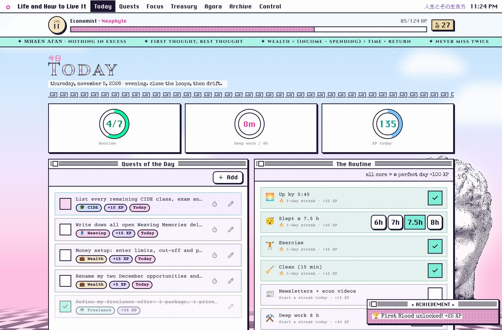
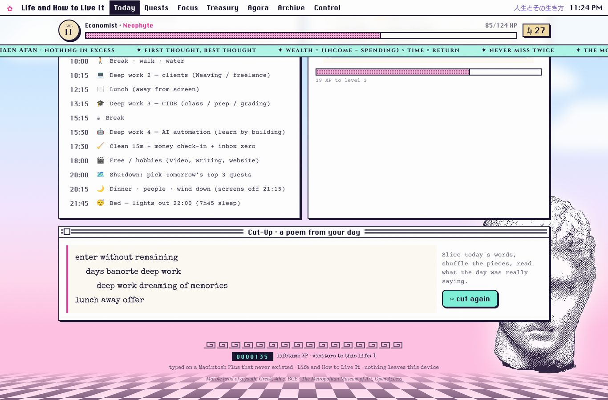
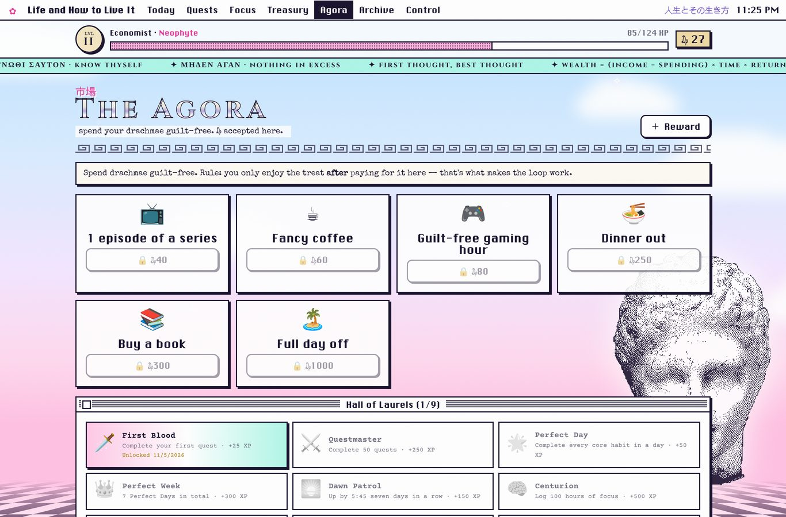
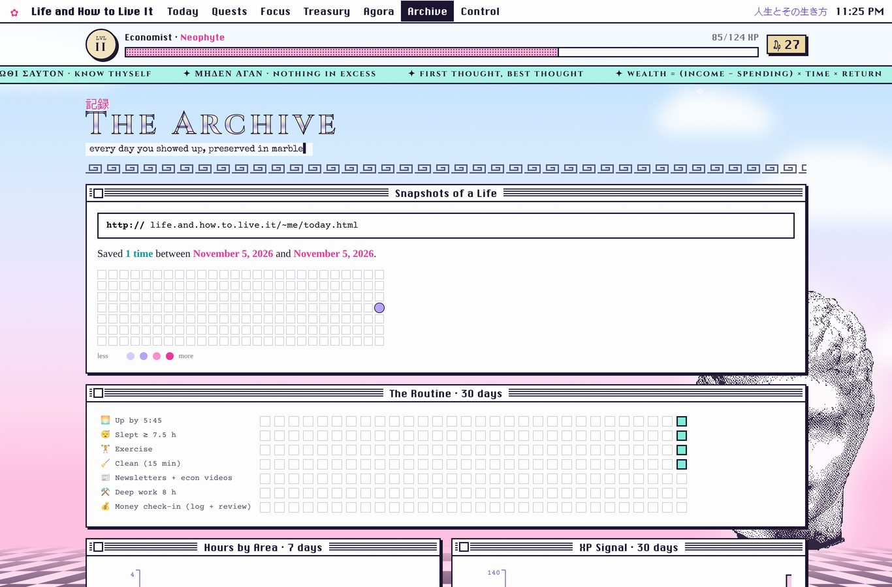
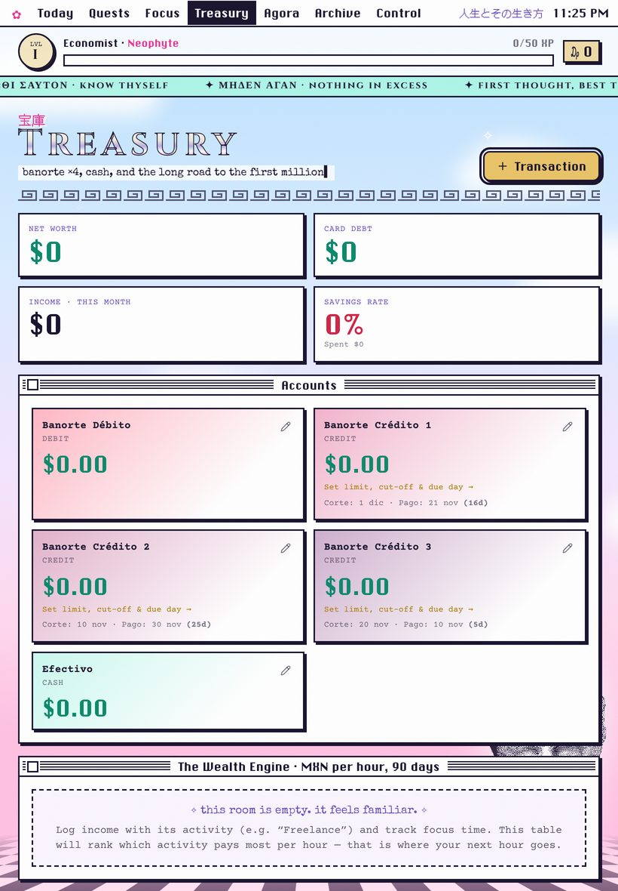

# ☼ Life and How to Live It

*人生とその生き方 · a personal operating system: Macintosh Plus × vaporwave × Greek marble × dreamcore × Beat typewriter*

A personal, offline-first app for **tablet + laptop** that turns your work, routine and money into a game.

- ⚔️ **Quests** for 8 areas: CIDE teaching · Weaving Memories · Freelance web dev · AI automation · Video · Writing · Personal website · Wealth & admin
- 🛡️ **Routine**: up by 5:45, ≥ 7.5 h sleep, exercise, clean, newsletters + econ videos, 8 h deep work, money check-in, with streaks and a 🌟 Perfect Day bonus
- ⏱️ **Focus timer** that feeds your 8-hour goal and your hours per area
- 💰 **Treasury**: Banorte debit + 3 credit cards (cut-off / pay-by alerts, utilization), net worth, savings rate, **MXN-per-hour by activity**, opportunity pipeline (your December opportunities), wealth goals
- 🎮 **Game layer**: XP, levels and titles, coins, reward shop, achievements, reward toasts
- 📅 Export your ideal day to your calendar (`.ics`) for reminders · JSON backup/restore · installable PWA

## Quick start
```bash
npm install
npm run dev        # http://localhost:5173  (use the Network URL on your tablet)
npm test
npm run build
```

## Docs (read in this order)
| File | What |
|---|---|
| [`docs/00-MASTER-PLAN.md`](docs/00-MASTER-PLAN.md) | **The strategy**: activity portfolio, routine, wealth plan, December decision framework, 90-day campaign |
| [`docs/01-PRD.md`](docs/01-PRD.md) | Product requirements, MVP scope, success metrics |
| [`docs/02-ARCHITECTURE.md`](docs/02-ARCHITECTURE.md) | Stack, folders, data flow, **invariants**, sync design |
| [`docs/03-DATA-MODEL.md`](docs/03-DATA-MODEL.md) | Tables, entities, ledger refIds, migration recipe |
| [`docs/04-GAME-DESIGN.md`](docs/04-GAME-DESIGN.md) | XP economy, levels, achievements, planned mechanics |
| [`docs/05-ROADMAP.md`](docs/05-ROADMAP.md) | Phases P0–P5 as agent-sized tickets with acceptance criteria |
| [`docs/06-AGENT-MANUAL.md`](docs/06-AGENT-MANUAL.md) | **How to build this with Cursor**: setup, loop, prompt templates, troubleshooting |
| [`docs/07-DEPLOY.md`](docs/07-DEPLOY.md) | Deploy to Vercel/Cloudflare and install on iPad/Android/laptop |
| [`docs/08-DESIGN-SYSTEM.md`](docs/08-DESIGN-SYSTEM.md) | The look: "Floral Dream" (tokens, fonts, windows, imagery, voice) |
| [`docs/prompts/`](docs/prompts) | Copy-paste prompts per phase |
| [`AGENTS.md`](AGENTS.md) + [`.cursor/rules/`](.cursor/rules) | Rules any coding agent follows automatically |

## Status
**v0.1 MVP**: all screens working, data stored locally (IndexedDB), 13 unit tests passing. Next: Phase 0 (deploy + install), then Phase 1.

## Screenshots





